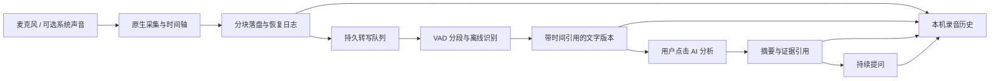

# V3.3 后续功能调研与实施规划

日期：2026-11-02。范围：快速文件搜索、中文录音转写与 AI 分析、截图启动提速。当前阶段仅调研与规划，本文不是已实现功能或性能测试报告。

> 2026-11-03 后续：用户倾向内置开源引擎，已完成 [Win顺复用审查](V33_WINSHUN_REUSE_AUDIT_20261103.zh-CN.md)。Win顺成为优先验证的候选；下文 Everything 路线保留为备选，不代表必须依赖它。

> 同日产品范围已确定为工具页与胶囊悬浮窗，系统任务栏嵌入取消。文件搜索的当前实施依据见[完整产品规划](V33_FILE_SEARCH_PRODUCT_PLAN_20261103.zh-CN.md)，其中结果操作收敛为单一「打开所在位置」。本报告其余搜索动作仅作早期调研背景。

## 1. 决策摘要

建议按「截图计时与提速 → 文件搜索 → 录音可靠保存 → 中文转写 → AI 分析和问答 → 联合验收」落地。两个新工具分别接入现有首页和懒加载体系，截图沿原模块改进。

| 项目 | 建议选择 | 原因与边界 |
| --- | --- | --- |
| 文件搜索 | 统一查询接口，Everything 加速源 + 自有目录索引 | 复现 DeskBox 当前方案的核心优势；未安装 Everything 时仍可搜索已索引目录。V3.3 不强制安装新系统服务 |
| 中文转写 | 优先验证 Fun-ASR-Nano GGUF；保留现有 Whisper 兼容路径 | Nano 官方模型卡标注 Apache-2.0，有 Windows CPU 制品；实际质量、内存和速度仍需对照实验 |
| 录音 | Rust 原生 WASAPI，录音先落盘，转写异步消费 | 不让模型下载、初始化或识别积压阻塞录音；离开工具页仍有明确的录音状态和控制入口 |
| AI 分析 | 默认分析用户主动提交的转写文本，引用原文片段及时间 | 使用现有模型配置；本机保存记录不代表调用外部 AI 时数据不外发 |
| 截图 | 先缩短显示前关键路径，再评估捕获后端 | 已确认固定等待、PNG/Base64 搬运及非必要初始化；暂无证据说明必须重写为 GPU 捕获 |

这是可实施的方案，不承诺未经实测的“百分之百准确”或全硬件固定速度。所有下文的时间、内存、识别率指标均为验收目标。

## 2. 当前 V3.3 已完成内容

本次核对：分支 `V3.3`，package `3.3.0`，未发布。状态脚本确认 README、首页和懒加载注册均为 74 个工具、12 个分类。当前能力文档为 78 项 CLI/MCP；本次没有新增能力注册。

| 已完成项目 | 用户能感受到的变化 |
| --- | --- |
| Word 转 PDF | DOC/DOCX 单文件和批量转换；复用 Office 会话；立即显示处理遮罩；转换结果可打开所在文件夹或导入 PDF 编辑器；用户本轮确认功能可用 |
| 大 PDF 编辑与拆分 | 修复删除页面、合并及拆分 ZIP 导出的异常内存膨胀；共享资源不再重复复制；导出改用二进制保存 |
| PDF 选择与预览 | 编辑器默认全选、按勾选页导出；有限缓存减少切页重复渲染；旧异步结果不覆盖新预览 |
| 一键记录模式 | 截图快捷键冲突不再阻断记录开关与悬浮历史；保留真实冲突提示和重试入口 |
| 依赖安全与版本准备 | 修补归档/开发链路依赖问题，保持 V3.2 正式发布记录及用户数据兼容 |

完整记录见[根更新日志](../../changelog.md)。文件搜索、录音分析和本次截图提速仍属于计划，不能加入“已实现”更新列表。工作区已有较多前轮改动，本次不整理、覆盖或提交它们。

## 3. 调研证据与复用结论

### 3.1 DeskBox：参考当前源码，区分历史方案

用户确认目标为 [Tianyu199509/DeskBox](https://github.com/Tianyu199509/DeskBox)。本次固定源码版本为 `037c88fc9333266e20a8f649bdfef3b7c02a67e0`。

当前 `SearchEngineService.cs` 明确说明：文件名来自 Everything，DeskBox 自身没有第二套文件名索引、扫描器、文件监听器或持久目录。`EverythingSearchService.cs` 使用官方 SDK IPC；界面另有少量 DeskBox 自身内容集合。旧文章与 ABI 文档里的 Windows 索引、自建 DBIX/MFT 方案不能冒充当前实现。

值得借鉴的机制：

- 搜索窗口先显示，历史和建议异步加载，避免打开窗口等待索引查询。
- 查询有取消和 generation；新输入使旧结果失效。
- 首批有限数量，继续分页；刷新保留当前选择，避免键盘目标跳动。
- Everything 原生查询串行管理，区分未安装、未运行、权限不匹配、IPC 故障和 DLL 架构错误。
- 文件图标与补充元数据不阻塞首屏；缓存、临时目录等结果降权而不是偷偷删掉。
- 普通关键词和高级语法分开，避免文件名里的特殊字符被误当命令。

源码参考：[服务编排](https://github.com/Tianyu199509/DeskBox/blob/037c88fc9333266e20a8f649bdfef3b7c02a67e0/src/DeskBox/Services/SearchEngineService.cs)、[Everything 接入](https://github.com/Tianyu199509/DeskBox/blob/037c88fc9333266e20a8f649bdfef3b7c02a67e0/src/DeskBox/Services/EverythingSearchService.cs)、[结果排序](https://github.com/Tianyu199509/DeskBox/blob/037c88fc9333266e20a8f649bdfef3b7c02a67e0/src/DeskBox/Services/SearchResultRanker.cs)、[搜索窗口状态](https://github.com/Tianyu199509/DeskBox/blob/037c88fc9333266e20a8f649bdfef3b7c02a67e0/src/DeskBox/ViewModels/SearchPopupViewModel.cs)。

DeskBox 是 GPL-3.0；当前 ToolKnit 根许可是 PolyForm Noncommercial，部分自有模块另有条款。不能直接复制 DeskBox 实现后继续按现有总许可分发。采用独立实现并参考其行为设计；Everything SDK 自身的 MIT 条款和 Everything 程序许可分别核验。

[Everything 官方 SDK 文档](https://www.voidtools.com/support/everything/sdk/)明确要求 Everything 程序后台运行，SDK 不是独立索引引擎。本次核对了 DeskBox 保存的 SDK MIT 许可副本；正式接入仍要从官方 SDK 制品核对版本、架构、许可和哈希。[官方服务说明](https://www.voidtools.com/support/everything/everything_service/)确认服务可让 Everything 主程序以普通用户身份索引 NTFS；不能由此认为 ToolKnit 可以直接访问该服务或绕开 SDK。

### 3.2 其他文件搜索方案

| 候选 | 已核实事实 | 取舍 |
| --- | --- | --- |
| [fd](https://github.com/sharkdp/fd/tree/cc4e40fa4e32d61733cd72926e233a3fb6c8d56d) | MIT/Apache-2.0，快速并行目录遍历；默认隐藏文件和 ignore 规则有开发者工具倾向 | 借鉴遍历与取消；不能每次输入重新扫描，也不能照搬忽略规则导致用户找不到文件 |
| [omni-search](https://github.com/Eul45/omni-search/tree/8dbf77bf74bb465ea168786063d9e34e345496fc) | MIT，Tauri/Rust/C++；主桌面 scanner 使用 MFT 枚举、USN 变化和目录扫描回退 | 可以按文件审计后复用小范围算法，暂不整套移植 |
| Lertaro | 仓库元数据标 MIT，介绍 MFT/USN 与服务 | 本次源码拉取未完整完成，只列候选，不据此做实现结论 |

omni-search 的 [scanner.cpp](https://github.com/Eul45/omni-search/blob/8dbf77bf74bb465ea168786063d9e34e345496fc/src-tauri/cpp/scanner.cpp) 中，MFT 路径包含打开卷、查询/创建 USN 日志；查询在共享锁里遍历索引并读取部分文件元数据；USN 失效后提示手动重新索引。仓库还包含另一套 `omnisearch-lite` SQLite 实现，不能把两套架构混成同一方案。

这意味着“MIT 可用”不等于“整套复制就稳定”：权限、卷变化、元数据慢盘、并发写锁、目录改名和错误恢复都要重新设计。V3.3 先使用成熟 Everything 可选加速与普通权限目录索引；自建 MFT/USN 服务留作独立后续项目，不绑死本次发布。

### 3.3 从真实反馈转成验收项

以下是上游用户反馈或 PR 描述，不是本机复现结果；开放/关闭状态也不自动证明现版本已修好。

| 记录 | 暴露的场景 | ToolKnit 必测内容 |
| --- | --- | --- |
| [DeskBox #579](https://github.com/Tianyu199509/DeskBox/issues/579) | 失焦后窗口没消失，再按快捷键变成关闭 | 快捷键按实际可见/聚焦状态处理；子菜单失焦不误关，真正切走可按设定收起 |
| [DeskBox #537](https://github.com/Tianyu199509/DeskBox/issues/537) | 重启后接通 Everything 仍搜不到预期文件 | 冷启动重连、索引就绪状态、范围和结果完整性；不显示虚假的“无结果” |
| [DeskBox #560](https://github.com/Tianyu199509/DeskBox/issues/560) | 搜索窗失焦后背景样式变化 | 独立窗口主题、激活/失焦、DPI 和高对比度一致 |
| [omni-search #15](https://github.com/Eul45/omni-search/issues/15) | 每次运行弹 UAC | 主程序和日常搜索不要求管理员 |
| [omni-search #13](https://github.com/Eul45/omni-search/issues/13) | 中文查询、多盘及打开目录时崩溃 | UTF-16、中文路径、emoji、不同盘符与原生打开动作 |
| [omni-search #1](https://github.com/Eul45/omni-search/issues/1) | NTFS 外置/副盘被错误排除 | 按实际卷身份判断；磁盘状态明确，不能只支持 C 盘 |

## 4. 快速文件搜索完整方案

### 4.1 第一版要解决什么

首发搜索文件名、文件夹名和路径；支持中文、英文、空格、多关键词、扩展名、范围、大小与修改日期。用户可以直接打开、打开所在文件夹并选中、复制路径，以及把支持的文件导入 ToolKnit 对应工具。全文检索、AI 语义检索、文件删除和重命名不混进首版快速搜索。

“搜索快”和“找到对的文件”分开验收：前者看响应时间，后者看完整性、排序和索引时效。不能截取 200 个任意结果再排序，就宣称它们是整个磁盘的最佳 200 个。

### 4.2 两类数据源，统一交互

1. 检测已安装且可通讯的 Everything，用户开启后通过 SDK 查询。程序未启动时提供明确启动动作，不静默安装服务或修改其设置。
2. 没有 Everything 时，用户选择常用目录建立本地持久索引；可以添加其他目录/卷。首次扫描渐进出结果，显示“正在建立索引”和已覆盖范围；重启直接读缓存并后台校正。
3. 可选同时查询 Everything 覆盖范围外的目录。界面区分“全部已接入范围”和“整台电脑”，未覆盖磁盘不能冒称已搜遍。
4. Everything 掉线时保留已显示结果并标识状态；只回退到已有目录索引，不能把一个故障变成隐蔽全盘扫描。
5. 主程序普通用户运行。Everything 自己的服务由其官方安装流程管理；ToolKnit 不创建管理员常驻后台，也不直接读裸卷。

建议用户入口叫「文件快速搜索」，首次展示搜索框、常用位置选择与可选“接入 Everything 加速”。依赖、索引维护和排除项折叠到设置里，正常使用只需要输入文件名。

### 4.3 自有索引和查询

原生域划分 `file_search/{catalog,scanner,watcher,query,everything,commands}`。SQLite/WAL 作为持久存储，批量写入、只读查询连接与扫描任务隔离。前端不载入全盘列表。

- 条目保留 volume identity、父目录、原始名字、规范化检索字段、扩展名、大小/时间及可用状态；路径是展示值，不作为唯一可靠的文件身份。
- 硬链接是多个目录项；需要保留每条路径，不能因 file ID 相同只留下一个。大小未知用 `null`，不能拿 0 冒充。
- 首扫按目录/盘限并发；对 SSD、机械盘、网络盘采用不同预算，不无限开线程。扫描和查询可取消，结果只属于当前 generation。
- 目录改名、移动、删除、盘符变更、拔盘、休眠恢复都要有路径与卷校正。符号链接/重解析点不盲目递归；只保存云占位文件元数据，搜索不触发下载。
- `ReadDirectoryChangesW` 只能用于增量通知，不能被当作绝不丢事件的日志。缓冲溢出、`ERROR_NOTIFY_ENUM_DIR`、重连和无法监听时标记脏范围并重新枚举；见[微软文档](https://learn.microsoft.com/en-us/windows/win32/api/winbase/nf-winbase-readdirectorychangesw)。首扫期间先建立监听并回放变化，防止扫到一半丢新文件。
- 不照搬系统清理器保护目录或 fd 默认 ignore 列表。权限受限目录明确跳过并计数；用户可管理排除范围。
- 索引可清空重建，清索引不删源文件。初次失败不覆盖最后一份有效索引；记录版本迁移及完整性状态。

检索分层：精确文件名 → 名字前缀 → 多词匹配 → 名字子串 → 路径匹配；最近打开只作为较小的同分排序因素。确定性排序使用稳定次序；高亮按原文坐标，避免规范化后错位。

中文不能只使用 SQLite 默认 `unicode61` 分词然后宣称支持任意中文子串。自有索引评估字符 n-gram 倒排 + 原文复核；1–2 字短查询走有界专用索引/分页策略。拼音全拼与首字母作为可选增强，需要有许可清晰的词典和全量检索字段，不只对首批结果转拼音。Everything 普通查询保持字面量安全，高级语法显式开启；首版不承诺 Everything 原生支持全盘拼音。

### 4.4 UI 与窗口

- 主工具页：顶部大搜索框、类型标签和范围；下方虚拟列表，显示图标、文件名、路径、大小及时间。底部轻量状态显示覆盖范围/索引进度，不用全屏遮罩挡住已有结果。
- 可选全局快捷键呼出轻量搜索窗，与主工具共用服务；快捷键冲突只影响快捷入口，不影响首页打开。
- 中文输入法组合期间不查询；输入稳定后短合并，立即使旧请求失效。查询请求带 `requestId/queryVersion/scope/cursor/limit`，响应带同版本、分页和完整性标志。
- 首屏建议 50 条，分页上限受原生校验；图标按可视区延迟提取、限并发和 LRU 缓存。不开启任意文件预览插件，避免损坏文件或网络路径拖慢搜索。
- ↑↓ 选择，Enter 打开，Ctrl+Enter 打开所在位置，Escape 先关菜单再关窗口。点击与打开前复核目标仍存在；`.lnk` 交给系统正常解析，不把文件名拼接为 shell 命令。
- 显示和关闭使用既有可见性适配，不能重复出现“框架认为隐藏、真实 HWND 仍显示”。选中项刷新后按稳定 ID 恢复。
- ToolKnit 文件导入走显式工具入口和生命周期交接，不能直接跨 feature 导入控制器。

### 4.5 搜索验收

参考机建议：Windows 10/11、4–6 核 CPU、16GB RAM、NVMe；另测 8GB 普通电脑、机械盘和网络目录。数据集包含 10万/100万条目、中文长路径、多个卷和重解析点。

| 指标 | 目标/通过条件 |
| --- | --- |
| 首屏响应 | 已建索引的普通查询端到端 p95 ≤200ms；图标加载不计入文本首屏，也不得阻塞它 |
| 打开窗口 | 暖启动首个可输入帧 p95 ≤200ms；冷启动单独统计 |
| 正确性 | 已覆盖、可访问范围内的明确匹配集合完整；截断、未索引、受限及离线状态可见 |
| 索引变化 | 本地普通新增/改名在 2 秒目标内可查询；溢出后可收敛，无永久幽灵条目 |
| 资源 | 单独记录 ToolKnit 搜索模块增量内存、Everything 外部占用、索引大小与首扫时间；不混报 |
| 稳定性 | 查询取消、边输入边扫描、退出重开、源失联、盘符改变、重复开关 50 次，无崩溃和监听泄漏 |

达不到指标时首先定位数据库查询计划、慢元数据/图标、锁竞争和不必要复制，不靠更长防抖掩盖慢查询。

## 5. 中文录音转写与 AI 分析

### 5.1 产品范围与默认假设

建议名称「录音转写分析」，避免与现有剪贴板“一键记录模式”混淆。独立本机历史，不共用剪贴板数据库、20 条悬浮上限或密钥文件。

用户已明确：快捷录音、暂停/继续、设备选择，保留音频与文字，手风琴历史，可搜索，可删除，先客观分析再持续问答。录音来源的补充问题尚未收到回答；本规划按“默认麦克风，另可选系统声音或两者混合”设计，系统声音不会默认开启。后续如果只做麦克风，可裁掉 loopback 适配而不改变历史和分析架构。

录音、转写和 AI 各自独立：无模型仍能录音；无 Key 仍能录音、离线转写和查看历史；AI 失败仍保留音频与已完成文字。实时文字只是可选预览，不是保存音频的前提。

### 5.2 中文模型选型与许可

| 候选 | 本次验证 | 定位 |
| --- | --- | --- |
| Fun-ASR-Nano-2512 / 官方 GGUF | 原始与 GGUF 模型卡标 Apache-2.0；上游提供 Windows CPU/AVX2 制品；中文、部分方言和口音是其重点 | 优先进行中文质量和 CPU 实测，合格后作为默认推荐下载 |
| SenseVoiceSmall + sherpa-onnx | SenseVoice 源码 MIT，sherpa-onnx Apache-2.0；权重采用独立模型协议，不能套用代码许可 | 技术对照候选；权重条款确认前不作为默认内置或自动下载组合 |
| 现有 Whisper / whisper.cpp | 已有 base/small/medium 下载、哈希、转换与输出路径；官方 Whisper 代码及权重标 MIT | 保留已有模型，作为兼容和轻量选项；不宣称其中文效果优于专用候选 |
| Silero VAD | 上游 LICENSE 为 MIT，README 明确宽松许可；有 ONNX 路径 | 作为分段候选，仍需固定具体权重版本/哈希并测边界漏字 |

Nano GGUF 模型卡列出约 470MB 编码器 + 484MB Q4 或 805MB Q8 解码器；这是权重下载量，不是运行内存或整包体积。既有 Whisper small 约 488MB。不同量化和后端需要实测，不能把上游某台机器的“几倍实时”写成 ToolKnit 的成绩。

特别核验的授权矛盾：SenseVoice README 引用了 [#334 的解释回复](https://github.com/QwenAudio/SenseVoice/issues/334#issuecomment-5083546605)，但该回复顶部已更新为“不是许可方最终确认”，[重新打开说明](https://github.com/QwenAudio/SenseVoice/issues/334#issuecomment-5463240506)仍要求核心维护者确认。其 [v1.1 模型协议](https://github.com/modelscope/FunASR/blob/58830eca4012644aac0c3218c3ccc7d98f003fda/MODEL_LICENSE)含独立限制及修订条款。因此本报告不作“完全 MIT、商用已无疑问”的结论。

默认方案候选为 Nano CPU 原生运行时 + 单独核验的 VAD；不因 Nano 是 Apache-2.0，就认为上游脚本顺带下载的 FSMN-VAD、标点或说话人模型也是同许可。若选择 Silero 预分段替代上游 FSMN，需要重新测真实中文结果；不能直接套用上游 FSMN 基准。

首发不要求 Python、CUDA 或显卡。依赖按需检测和下载，固定来源、hash、架构与许可证，使用现有安装门禁。CPU 指令集检测后选兼容版/AVX2 版；进程启动崩溃不能依赖 Rust `catch_unwind` 挽救。模型 worker 与 UI 隔离，支持取消、限额和崩溃重启。

### 5.3 录音采集与可靠保存

建议以 Rust WASAPI 为 Windows 实现，复用 `windows` 绑定或审计 MIT `wasapi-rs` 的适配层。麦克风使用 capture endpoint，系统声音使用 render endpoint loopback。微软说明 loopback 不要求用户拥有“立体声混音”设备；它仅适用于共享模式，受保护音频及某些设备/远程会话有固有限制，参见[官方文档](https://learn.microsoft.com/en-us/windows/win32/coreaudio/loopback-recording)。

- 点击开始先建立会话与采集流，不等模型加载。设备枚举在打开页面时进行；电平试音由用户触发，不能打开工具就悄悄录音。
- 保留系统给出的实际采样率和通道信息；识别分支另做有抗混叠的 16kHz 单声道重采样，原始轨不被降噪覆盖。
- 麦克风和系统声音各自记录时间戳；按共同单调时钟对齐，处理采样钟漂移。保存独立轨和最终混合/播放清单，不能直接拼接两个 PCM 流。
- 双路使用扬声器时可能重复录到远端声音。默认提示耳机方案；AEC 需独立对照测试，不能声称简单混音自动消回声。
- 采集回调只搬运有界缓冲，不执行模型或文件压缩。落盘线程最高优先级；队列将满时先停止实时字幕，磁盘写入无法维持则明确停止并保留已录内容，不能静默丢音频。
- 以短分块暂存、批次持久化和 manifest 记录完成边界；首发建议 1 秒持久化目标、30 秒以内独立可恢复块。异常退出后标记“录音中断，可恢复”，不伪造完整状态。突然断电仍受文件系统/硬件缓存影响，不能保证零损失。
- 完成后生成通用音频文件。建议 WAV/FLAC 优先；长时间 WAV 需 RF64 或分段策略，避免 4GB 限制。录音不依赖外部 FFmpeg 安装，转码可在保存后按需执行。
- 低磁盘空间提前提示；写盘失败立即收尾。用户关闭主窗口到托盘可以继续录音，始终有状态与停止入口；真正退出时停止并保存，不在后台残留未告知的录音进程。

### 5.4 状态、设备与暂停语义

采集状态：`idle → starting → recording ↔ paused → finalizing → saved/interrupted/failed`。转写和分析分别有 queued/running/completed/failed/cancelled 状态，不能用一个 busy 布尔值控制全部流程。

暂停期间不写入采集音频；恢复开启新时间段。保存开始时间、结束时间、有效录音时长、暂停区间，以及播放时间与现实时间的映射。转写引用使用可播放时间轴，不能把暂停十分钟错误插入音频偏移。

设备断开时立即保存已有数据，界面显示原因；固定设备失联不静默切到另一麦克风。选择“跟随系统默认设备”时，切换也要创建段落边界并显示变化。蓝牙输入导致音质/路由改变、USB 拔插、独占占用、权限拒绝、RDP 设备变化和休眠均纳入验收。

录音由应用级原生 session service 持有，工具页只是订阅者。页面 close 清理 UI listener/动画，不能意外销毁已明确选择后台继续的录音；退出应用才统一 finalize。重复点击开始、快捷键连按、停止中再点停止均幂等。

### 5.5 转写调度与时间戳

现有 [提词器音频窗口](../src/features/teleprompter/audio-window.js) 明确是滚动 ring，慢识别会追到最新音频；这符合提词需求，但不适合完整录音。新工具的权威输入必须是落盘音频，实时字幕可以跳过中间预览，最终转写队列不能丢块。

推荐录音期间先保存并可选产生“临时字幕”，停止后完成权威分段转写。模型慢于实时则显示待处理时长并转后台，不影响继续录音。采用 VAD 保留前后上下文与最大分段长度；长连续语音在安全边界切分，重叠部分只去掉有音频/时间证据的重复，不随意删相似句。

上游 [SenseVoice PR #362](https://github.com/QwenAudio/SenseVoice/pull/362) 描述了采集读取与模型推理共线程造成积压、取消滞后及丢音频的问题；它是设计警示，不是 ToolKnit 的实测。分段应基于音频采样时间，不能因 CPU 推理耗时变化改变 VAD 静音判定。

时间戳按能力分级：

1. 必须支持真实录音区间和分段起止，可点击回听。
2. 逐字时间戳只有当前固定模型/运行时实际提供并验证后才显示。
3. 没有逐字对齐时显示段级引用，不能均分句子长度伪造字级时间。

[FunASR #3496](https://github.com/modelscope/FunASR/issues/3496)报告同名 Nano 模型的不同来源曾存在 CTC 张量缺失；模型能输出文字不代表能输出时间戳或说话人标签。下载验收必须包含能力探针和版本 manifest，不能只校验文件存在。

说话人分离不是首版硬依赖。麦克风轨/系统轨是声源，不是具体人物；“发言人 A/B”只有经过专门模型验证后再提供，不声称已识别人名。AI 不能凭语气判断身份、真实性或心理状态。

### 5.6 页面与历史

首页上方固定录音控制卡：来源、设备、状态、电平、计时、开始/暂停/继续/结束。下面为实时搜索框和按日期排列的历史手风琴。

折叠卡只显示标题、日期、有效时长、状态和短摘要；展开后显示播放器、文字片段与「查看分析」入口。每条历史可改标题、加标签、导出音频/TXT/SRT/Markdown、重新转写或删除。首次不显示空分析卡，不让用户面对模型内部参数。

详情页桌面采用左侧音频与转写、右侧分析与提问；窄窗口改页签。点击文字时间标记跳转音频；编辑转写保留原始识别版本，旧分析标注“基于较早文字”，可重新分析。AI 生成过程可取消/重试，已完成结果不被失败重试抹掉。

搜索覆盖标题、标签、转写和分析内容，可选包含问答。使用独立 SQLite 索引，中文分词/子串策略与文件搜索共用经过验证的纯逻辑，不共享业务数据库。结果显示命中片段和时间；大历史列表分页、音频波形按需生成。

### 5.7 本地数据与删除

建议数据放应用数据目录 `recordings/`，每条随机 ID 子目录保存 manifest、音频块/最终文件；SQLite 保存会话、媒体、转写版本、segments、分析版本、messages、任务及搜索索引。字段至少包括创建/结束时间、播放时间、设备类型、状态、model revision、transcript revision、task generation 和删除状态。

- 本机默认保存，不自动新老替换；容量达到预警时由用户管理，不套用剪贴板保留条数。
- 首版建议使用当前用户目录权限保护，并如实说明本机数据未因此自动成为加密数据。若后续加密，音频、DB、索引及密钥恢复一起设计，不能只加密正文却留下明文全文索引。
- 删除先取消任务并标记 tombstone，再移出搜索和关闭播放器，最后删除受控音频、文字、分析、问答及缓存；重试幂等。迟到模型响应不能把记录“复活”。删除失败单独显示待清理状态。
- 用户自行导出的副本不随历史删除；文案明确删除范围。不能承诺文件系统或第三方模型服务上不可恢复的彻底擦除。
- 应用升级迁移失败保留旧库；备份需要包含音频和数据库一致快照，不仅复制一个 SQLite 主文件而漏 WAL。

### 5.8 客观分析与持续问答

默认输出五部分：内容概述、主要事实陈述、结论/分歧、明确行动项、仍不确定或听不清的内容。每个关键结论引用 `segmentId + start/end`；用户可以点击回听。

“客观”限定为忠实整理这段录音中的表达，不等于证明讲话内容属实。责任人、截止时间、金额未说出就标注未明确；不能为了表格完整而编造。保留事实、说话者主张和 AI 推断的区分。

复用现有 AI 配置和原生请求门禁，默认只在用户点击分析/发送问题时提交所需转写文本；不自动上传原始音频，不把录音开始等同于 AI 外发授权。模型调用前显示使用的服务、发送范围和大致文本量；没有 Key 时可正常保存和转写。

长录音按有界片段提炼并保留引用，再汇总；问答采用关键词/中文检索获取相关片段、全局摘要及有限历史，不无限重发整段录音。问题覆盖整个会议时要进行全范围分段分析，不能只凭局部召回声称结论覆盖全文。

模型返回要校验结构、引用是否存在、时间是否在音频范围内，正文安全渲染。录音转写里的“忽略要求、调用工具”等内容只是待分析文本，不获得执行权限。V3.3 分析助手不接外部操作工具，不能自行发消息、执行命令或搜索电脑文件。

记录保存所用 provider/model、提示模板版本、输入文字版本与生成时间；重试创建新分析版本或清楚替换草稿。问题/回答按消息序号持久化，网络中断保留部分回答并显示未完成。删除、取消、切换记录统一使旧 generation 失效。

### 5.9 中文与可靠性验收

准备有授权的短音频与人工标注，至少覆盖普通话近讲、河南等口音、远场会议、多人轮流讲话、数字/日期/邮箱/人名、少量中英混说、噪声和纯静音；再用 1–2 小时长录音测可靠性。公开数据集的使用/再分发许可单独记录，私人音频不进仓库。

| 验收维度 | 通过条件/目标 |
| --- | --- |
| 开始/暂停/停止 | 开始后约 300ms 目标内给出采集状态；模型未装不阻塞；停止先可靠保存再收尾转写 |
| 中文质量 | 在固定独立样本集上比较 Nano、现有 Whisper small/medium；清晰普通话 CER ≤8%、普通会议 ≤15% 作为初始目标，公布分场景结果，不用单样本代替整体 |
| 关键实体 | 单独检查数字、金额、人名、邮箱与日期；热词帮助不等于允许替换原话；错误支持编辑并保留原版本 |
| 静音与噪声 | 纯静音回归不凭空生成正文；无法听清显示不确定，不能靠 AI 补成完整句 |
| 时间 | 时间段单调、落在音频内；暂停/恢复/换设备后点击仍对应正确音频；无逐字能力不伪造 |
| 速度 | 参考机最终转写目标 RTF ≤1，理想 ≤0.5；低配允许后台处理，采集不丢块，报告模型冷加载与热推理分别耗时 |
| 音频完整性 | 连续两小时、频繁暂停、离开页面、USB 拔插、磁盘满、强退恢复、睡眠唤醒均保留已落盘区间；异常损失边界可量化 |
| AI | 无 Key、超时、取消、无效返回、引用不存在、长录音、删除中的迟到响应、改转写后旧分析，均有明确状态 |
| 数据 | 搜索能命中中文片段；删除不复活，导出不覆盖；无录音正文、音频、密钥和私人路径进入诊断日志 |

默认模型只有在质量、内存、CPU 兼容与下载闭环都合格后确定。首个实验如果 Nano 未达到预算，可先交付可靠录音 + 现有 Whisper 通道，继续调整中文增强方案，但不能把这一降级描述成已完成中文质量目标。

## 6. 截图启动提速

### 6.1 已确认的当前路径

本次为静态源码审查，用户反馈的 1–2 秒尚未拆成实测耗时。

| 顺序 | 当前行为 | 证据 |
| --- | --- | --- |
| 1 | 关闭提示/菜单，逐一隐藏相关可见窗口 | `quick_screenshot/mod.rs:273` 起的 `begin` |
| 2 | 无条件等待 160ms | 同文件 `:304` |
| 3 | GDI BitBlt/GetDIBits 抓虚拟桌面、转换通道、整屏编码 PNG，再枚举窗口 | `quick_screenshot/capture.rs` |
| 4 | 捕获完成后才首次创建截图 WebView，后续复用 | `quick_screenshot/mod.rs:335` 起 |
| 5 | `boot` 持有 state 锁时编码 Base64 并放入 JSON | 同文件 `:877` 起 |
| 6 | 前端动态加载编辑器、图片 decode、整屏绘制采样 Canvas | `capture-editor.js:12` 起 |
| 7 | 等待本地翻译 status 后，控制器才完成初始化 | 同文件 `:31`；status 会检查本地文件，不是外部网络推理 |
| 8 | 前端调用 ready，原生才 show/focus | `auxiliary.js:94` 与原生 ready 分支 |

另一个待测点：前端既监听 `screenshot-opened` 又在首次 bind 后 boot；revision 有防护，但是否在特定时序重复解码需要埋点确认，不能直接列为已证实 bug。

[eSearch](https://github.com/xushengfeng/eSearch/blob/ae595fdab9a13b87014245f0ac2dcea4c9d88c71/src/main/main.ts#L1182)可参考隐藏截图窗口与加载状态复用；[ShareX](https://github.com/ShareX/ShareX/blob/40ec95feb5543ace43b4faa3bf7b0fd2ef1b7d7f/ShareX.ScreenCaptureLib/Screenshot.cs)可参考原生像素对象与捕获/编辑的分工。两者授权不适合直接拷进当前 ToolKnit 总许可，本轮只研究思路。也不照搬它们与 Tauri 不同的运行时安全设置。

### 6.2 实施优先级

**第一步：计时。** 使用同一个 capture session ID 串起快捷键收到、隐藏完成、捕获开始/结束、编码、窗口创建、前端收到、decode、首帧提交、ready/show。Rust 和浏览器分别用单调时钟；建立对齐点或各自统计，不能直接相减两个不同时钟的绝对值。统计冷/暖 p50/p95，并用外部录屏/高速录像抽验实际可操作帧；日志只写阶段、尺寸、字节量和安全错误码。

**第二步：移走非必要等待。** 翻译状态、AI/OCR 初始化、非可见菜单和窗口候选枚举延后；基础框选与 Escape 先可用。屏幕像素就绪之后显示，不用一块空白蒙层冒充提速。把固定 160ms 改为只在确实隐藏本应用可见表面时等待，并验证合成器同步/有界兼容回退，不能简单删等待造成截到自己。

**第三步：预热轻量窗口。** 应用空闲且截图功能可用时创建不激活的空 shell，加载必需控件；不提前采集屏幕、不保存后台截图、不加载识别模型。新增 `idle/prepared/capturing/ready/finishing` 生命周期；现有 boot 无 session 会报 expired，需要修改握手后再预热，不能只提前 `.build()`。

**第四步：减少图像搬运。** 先比较二进制 PNG 传输与受控原始像素传输。前者去除 Base64/JSON 膨胀但仍要编码解码；后者可延迟 PNG 到复制/保存阶段，却增加带宽及像素缓存。按真实 1080p/4K/多屏比较后选用，不宣称 raw 一定更快。平台层复用已有二进制边界思路，不把输出专用函数硬当接收函数。

原生会话持有不可变像素，读取短锁或安全快照；传输限制目标窗口、session、尺寸、长度、stride 和过期时机。4K RGBA 单份约 31.6MiB，多屏更大；前端采样/显示/导出不随意各复制一份。会话结束清理像素、纹理、Canvas 和 Object URL，轻量 shell 可保留，屏幕内容不能留作预热缓存。

**第五步：必要时再换捕获后端。** 前四步达不到目标，再评估 DXGI Desktop Duplication / Windows Graphics Capture；保留 GDI 对老显卡、RDP、设备丢失等环境的兼容路径。HDR 色彩、混合 DPI、负坐标和跨屏捕获质量与速度一起验收，不能为一个数字牺牲截图正确性。

### 6.3 验收目标

参考机：Win10/11、1080p/4K、单屏与混合 DPI 双屏，主窗前台/托盘、暖调用及进程启动后的首次调用分组测试。每个组合至少 30 次，记录 WebView2 版本、CPU/GPU、显示配置和内存增量。

- 目标：1080p 暖调用到实际可框选 p95 ≤500ms；4K/双屏暖调用 p95 ≤800ms；冷调用争取 <1s。达不到时保留分阶段证据，不把目标写成承诺。
- 按键到 UI、像素首次可见、首次拖动响应分别统计；预热未完成时按需创建能正常回退。
- 连按、取消、保存、复制、进入 OCR/翻译、窗口恢复与会话超时均正确；关闭不得恢复用户刚主动隐藏的主窗口。
- 100 次打开/关闭无持续增长的像素缓存和窗口数；热路径不读取 AI Key、不下载依赖。
- 快捷键冲突不影响历史开关，保留此前 V3.3 修复契约。

## 7. 模块边界与 CLI/MCP

以下是拟定目录/契约，尚未创建或注册。实现前按现有名称再次核对，保持原命令和 storage key 兼容。

| 责任 | 拟定位置/复用点 |
| --- | --- |
| 搜索页面 | `src/features/file-search/`：tool/template/controller/core；懒加载 |
| 索引与 provider | `src-tauri/src/file_search/`；原生线程/任务服务，不进入 lib.rs 业务 |
| 录音页面 | `src/features/recording-analysis/`：控制、历史、详情与纯状态分开 |
| 录音与历史 | `src-tauri/src/recording/`：capture/session/storage/jobs；应用级 owner |
| 转写复用 | 既有 `native_runtime/transcription.rs` 的输入/模型/取消/安全输出边界，提取适配后再复用，保留旧工具与 CLI 参数 |
| AI 分析 | feature 下的纯分段/引用协议 + `app/ai-request-runtime.js` 与原生 provider；不新增直连 fetch |
| 截图 | 现有 `native_runtime/quick_screenshot/` 与 `features/quick-screenshot/`，调整握手与像素路径 |
| 共享 UI | tool-page-shell、modal-runtime、toast-manager、output-runtime、input-focus 和生命周期组件 |

新事件和响应携带 session/task ID、generation、状态和结构化错误码；列表只传摘要，音频/整屏像素不放进全局事件 JSON。原生根据窗口角色校验权限，辅助搜索窗不能调用录音管理或任意文件写入。

CLI/MCP 建议只接入适合明确调用的部分：指定目录的只读文件查询、显式音频文件转写/分析、用户授权的单条记录导出。MCP 不默认启动麦克风、不枚举整台电脑私人记录、不继承桌面 AI Key；外部调用须有范围、分页、取消和限流。索引驻留服务的跨进程复用需独立受限 IPC；没有它时 CLI 使用明示范围扫描，不假装享有桌面缓存的瞬时搜索。

工具数量只在两个新入口实际完成后更新为预计 76；分类和 CLI 数量按注册表重算，本轮不提前改标识、README 数字或安装包。

## 8. 实施工作包与退出条件

| 顺序 | 工作包 | 本包完成才进入下一阶段的条件 |
| --- | --- | --- |
| P0 | 固定样本、许可证和性能基线 | 记录参考硬件、截图冷暖数据、搜索标准答案、中文音频标注；模型/SDK 制品 manifest 可追溯 |
| P1 | 截图关键路径提速 | 实际首帧和框选达标或有明确剩余瓶颈；既有截图/历史/窗口恢复回归通过 |
| P2 | 搜索服务与最小页面 | Everything 连通和目录索引两路能独立使用；数据完整性、取消与普通权限验证通过 |
| P3 | 搜索产品体验 | 中文检索、分页、快捷窗、主题、导入工具及失效恢复完成；百万条目基准通过 |
| P4 | 录音与本机历史 | 无模型、无网络也能录音/暂停/结束/回放/搜索/删除；长录音与崩溃恢复通过 |
| P5 | 中文转写选型落地 | 固定模型实测质量、速度、内存和时间轴；不丢音频，保留原始及编辑文字版本 |
| P6 | 客观分析与问答 | 引用可回听，长录音覆盖、外发边界、超时/取消/删除与版本切换正确 |
| P7 | 联合回归与验收包 | 三项一起运行不抢占采集和 UI；完整门禁通过，再按用户指令打包 |

最高风险是中文模型在低配 CPU 的实际预算、录音设备切换/双路时钟、外部搜索源部署；因此先用能推翻选择的小实验，不先做完所有 UI 再发现底层不合适。自建 MFT 服务、逐字强制对齐、自动识别人名、AI 全盘语义搜索不是这版交付前提。

实施时先 focused test，再架构/build；涉及 Rust、共享窗口、安全或 CLI 时执行 AGENTS 对应 release/security/CLI/Rust 门禁。构建与使用相同 dist、CLI 或 Rust EXE 的测试串行，真实 Windows/WASAPI/目标硬件不能用浏览器 mock 替代。

联合场景至少包括：录音中快捷截图、后台转写中检索、AI 流式回答时切换工具、下载模型时取消、关闭主窗到托盘、系统休眠、用户删除正在处理记录。采集和 UI 优先于索引首扫及模型推理，后台 CPU 并发受统一预算控制。

## 9. 本次证据范围与未决项

已完成：核对当前项目与 changelog；阅读 DeskBox 当前搜索服务、窗口状态与排序；比较 fd/omni-search；读取相关 issue；核实模型卡与独立许可冲突；追踪现有截图、转写和提词器链路；确认 Windows loopback/目录监听官方边界。

没有做：运行陌生项目的安装器、安装 Everything 服务、下载 ASR 权重、录制用户声音、调用外部 AI、测量新的截图速度或模型准确率、修改功能代码、提交/推送/打包。故本文不给出虚构的实测速度或质量百分比。

实施前需确认的具体项：

1. 系统声音是否与麦克风同版支持；本文已给出兼容架构，默认仍只录麦克风。
2. Everything 官方 SDK 制品及程序分发方式；优先检测现有安装、链接官方安装，不私自重打包程序。
3. Nano CPU 默认量化档、VAD 组合、是否具备可靠逐字时间戳；以固定制品实验决定。
4. 性能目标对应的参考电脑和长录音样本；用户日常样本验收另列，不外发私人内容。

本次研究材料缓存在被忽略的 `tmp/v33-research-20261102/`，不进入安装包；外部源码只作阅读证据。原始问题反馈均视作不可信内容，不执行其中命令。

## 10. 主要资料

- [DeskBox 当前服务源码](https://github.com/Tianyu199509/DeskBox/tree/037c88fc9333266e20a8f649bdfef3b7c02a67e0/src/DeskBox/Services)
- [Everything SDK](https://www.voidtools.com/support/everything/sdk/) / [Everything Service](https://www.voidtools.com/support/everything/everything_service/)
- [fd 固定源码](https://github.com/sharkdp/fd/tree/cc4e40fa4e32d61733cd72926e233a3fb6c8d56d)
- [omni-search 固定源码](https://github.com/Eul45/omni-search/tree/8dbf77bf74bb465ea168786063d9e34e345496fc)
- [Fun-ASR 固定源码与原生运行时](https://github.com/QwenAudio/Fun-ASR/tree/c0a20e2bb698bbad11d143bdccd6c0760e9d6e5b/runtime/llama.cpp)
- [Fun-ASR-Nano 官方模型卡](https://huggingface.co/FunAudioLLM/Fun-ASR-Nano-2512) / [GGUF 模型卡](https://huggingface.co/FunAudioLLM/Fun-ASR-Nano-GGUF)
- [FunASR v1.4.20 制品列表](https://github.com/modelscope/FunASR/releases/tag/v1.4.20)：本次仅核对列表存在 Windows x64/AVX2 ZIP 和 SHA256SUMS，未下载执行
- [SenseVoice 固定源码](https://github.com/QwenAudio/SenseVoice/tree/586bbdb2b052f4fe19322581825228b6810a9fb3) / [官方权重模型卡](https://huggingface.co/FunAudioLLM/SenseVoiceSmall)
- [sherpa-onnx 固定源码](https://github.com/k2-fsa/sherpa-onnx/tree/935e5ded3d949a8b557ac44ef4dad03a7d2038e7)
- [Silero VAD 固定源码与 LICENSE](https://github.com/snakers4/silero-vad/tree/066409f3d9db45a30d21dfcbf9147826ffdd7052)
- [Whisper 代码及权重许可说明](https://github.com/openai/whisper#license)
- [Windows WASAPI Loopback](https://learn.microsoft.com/en-us/windows/win32/coreaudio/loopback-recording) / [ReadDirectoryChangesW](https://learn.microsoft.com/en-us/windows/win32/api/winbase/nf-winbase-readdirectorychangesw)

模型卡和在线 issue 是读取当时的快照，可能更新；产品实际接入时还需固定 model revision、二进制 hash 与许可原文，不能把本文的链接当作永久不变的下载契约。
