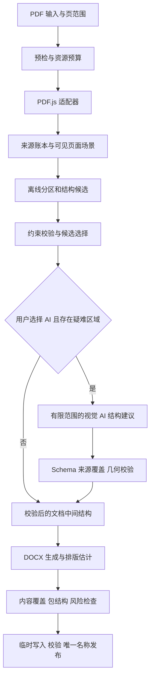

# ToolKnit V3.2 PDF 转 Word：研究结论与完整实施规划

日期：2026-10-18。状态：研究与规划完成，用户已批准进入实施。本文保留设计目标；实际交付、验证与未覆盖项以 [维护记录](PDF_TO_WORD.zh-CN.md) 为准。

本轮采用源码阅读、公开 Issue/PR 分析、用户授权样本复核和隔离实验。证据、版本和实验局限见 [研究依据与实验记录](V3_2_PDF_TO_WORD_RESEARCH.zh-CN.md)。本文的“完成”指需求、技术路线、失败策略和验收标准已形成闭环，不表示任意 PDF 都能无损转成可编辑 Word。

阅读导航：[最终建议](#1-最终建议) · [样本处理](#4-用户样本的专门处理方案) · [架构](#5-总体架构) · [本地算法](#8-离线排版推断算法) · [AI增强](#9-可选-ai判断结构不重写原文) · [Word生成](#10-docx-生成策略) · [产品交互](#11-页面设计和交互) · [性能与体积](#13-性能容量和安装体积) · [验收](#14-质量验证体系) · [实施阶段](#15-研发分阶段计划) · [许可](#17-许可与长期维护) · [完成度](#19-本轮完成度)。

## 1. 最终建议

采用 **PDF.js 解析与渲染 + 自研离线排版推断引擎 + 可选视觉 AI 结构建议 + MIT 许可的 docx 生成器**。本地模式是完整产品，AI 是复杂版面的增强路径。

首发围绕中文、英文及中英混排的原生文字 PDF，优先做好讲义、试题、报告和常见表格。用户不需要安装 Python、Office、排版模型或显卡运行库。扫描页本轮不做 OCR；图片仍可作为图片保留，但不能冒充识别出的可编辑正文。

核心质量顺序确定为：

1. 可见内容正确，隐藏内容不泄漏，原文件不改变。
2. 文字不漏、不重、不改；阅读顺序、数字和选项对应正确。
3. 段落、表格、页眉页脚可以继续编辑。
4. 页数、行距、图文位置接近原稿，不能为追求同页数而裁字或无限缩小字体。
5. 复杂区域可以明确降级、重试或调整，不静默丢弃。

这条路线可以避开引入 PyMuPDF 的 AGPL/商业授权依赖，但不是“不需要遵守任何许可”。PDF.js、docx、传递依赖及分发的字体/WASM 资源仍要保留相应许可和声明。

## 2. 已明确的产品边界

| 项目 | 本次决定 |
| --- | --- |
| 输入与输出 | 单个 PDF、指定页范围，生成一个可编辑 `.docx`；保留源文件 |
| 解析方式 | 默认本地；用户主动选择 AI 辅助，复用现有服务商、模型和 Key |
| 本地引擎 | 自研规则、几何、候选评分与约束求解；不训练/下载神经网络模型 |
| 语言 | 简体、繁体中文、英文及混排；不自动翻译、改写或简繁转换 |
| 扫描 PDF | 明确提示当前不支持文字识别；不可通过 AI 模式偷偷变成 OCR |
| 混合页面 | 原生文字可编辑，照片/扫描图保持图片；识别到全文图片页时单独处理 |
| 常规布局 | 标题、段落、列表、题目与选项、页眉页脚、图片、规则表格、分区多栏 |
| 复杂布局 | 先给结构风险提示；局部保留可见图像或让用户调整，不承诺全可编辑 |
| 不做的首发能力 | 批量队列、公式语义重建、手写识别、自动目录生成、任意复杂浮动排版、云端转换 |
| CLI/MCP | 引擎保持可测试、无 UI 依赖；本轮首发桌面入口，CLI/MCP 不默认新增能力 |
| 版本与发布 | 仍是 V3.2 未发布；本规划不升版、不打包、不提交、不发布 |

仓库已有的 `pdf-to-docx-smart-balanced-plan.zh-CN.md` 是 2026-08-03 的旧方案，包含 PDFium、OCR 模型和不同实现方向。本次 PDF 转 Word 以本文为准；旧文保留为历史，不把其中的模型下载、扫描件支持或进度误认为现有能力。

## 3. 研究后最重要的发现

| 发现 | 证据 | 对实现的直接影响 |
| --- | --- | --- |
| 用户样本文字量保住了，但排版仍会出错 | pdf2docx 输出 XML 中非空白字符计数一致，LibreOffice 却将 6 页排成 7 页，部分标题显示不完整 | “字数相同”和“生成成功”不能作为质量验收 |
| 页眉没有真正独立建模 | pdf2docx 的页眉 Issue 与文档级分析 TODO；样本页眉进入正文表格 | 在整份文档层面识别页眉/页脚，再与正文分开生成 |
| PDF 内容流顺序不是阅读顺序 | PDF.js Issue；两版本合成实验均返回 R2、R1、L2、L1 | 局部分区和阅读顺序重建必须独立于提取顺序 |
| 看不见的文字也能被提取出来 | 两版本都提取出不可见、裁剪外及白块覆盖的文字 | 增加可见性检查；不能把原始提取结果直接交给 AI 或 Word |
| 多栏、无边框表格、试题选项容易混淆 | pdf2docx 多栏讨论、pdfplumber 表格讨论 | 并行生成候选结构，用约束选择，不能只看 X 坐标分两列 |
| Word、WPS、LibreOffice 的排版有差异 | docx 历史 Issue 及 2026 年近期 PR | 显式表格宽度、单元格宽度、边距和字体；实际跨引擎验证 |
| Writer 已有可用基础，但不是 PDF 转换器 | docx 9.12.0 受控实验生成并渲染 4 页，分栏顶端对齐 | 可采用其 DOCX 原语；推断、质量检查仍需自研 |
| 本地依赖存在漂移 | 锁文件 PDF.js 6.2.108，本机 node_modules 为 6.4.299 | 开工先固定可复现环境；本轮已在两版本补测关键实验 |

上游旧 Issue 用于发现失败模式，不代表最新版仍有同一个 bug；Issue 关闭也不能替代本项目回归。具体区分见研究记录。

## 4. 用户样本的专门处理方案

用户授权的 6 页作业 PDF 是首个回归样本，不是唯一模板，不将私人文件或正文加入仓库。

### 4.1 页眉 Logo、说明文字与二维码

先根据跨页位置、大小、图像内容摘要、文字特征和正文起点判断是否属于重复页眉。Logo 和二维码是独立图像对象；中间说明文字是独立文字区域，横线是分隔装饰，不能把第一道正文标题一起吞进页眉表格。

Word 中可使用真正的 Header 容器，在其中采用明确列宽、零或小内边距的无边框表格安排 Logo、文字和二维码。正文起始位置由真实页眉占用高度和安全间距计算。首页特殊页眉、奇偶页眉及章首页变化分别建模，不能只因出现在顶端就认作页眉。

对这一结构验证：Logo 不变形，二维码不被有损压缩到无法辨认，中间文字不裁切，标题完整，六页不因页眉反复挤占正文而多出空白页。当前 Word 实验只验证了 LOGO/QR 文字占位布局；真正图片插入和二维码识读必须在实现阶段补验。

### 4.2 题目与 A/B/C/D 选项

题干是段落；单行、两列或四列选项形成 `optionGrid`，保留题号、选项标识和对应关系。只有语义连续的长正文才进入报刊式分栏，不能把 A、C 当成左栏正文，把 B、D 当成右栏正文。

短选项使用固定列宽的无边框 Word 表格；长选项按实际宽度换行或改为逐项段落。题干与首个选项尽量同页，单个选项不任意拆开；整题高于一页时允许合理分开，避免把整题强制粘在一起制造大空白。

### 4.3 标题、分页与底部内容

标题不放在固定高度正文表格中，不用 `EXACTLY` 行高遮住超出部分。按字体、行高和正文区域高度排版；每个源页保留来源关系。样本验收要求页眉、标题、全部选项完整，支持字体环境下六页输出对应六页；若有字体替换引起的溢出，必须显式提示，不能把字挤没来达标。

## 5. 总体架构



各层职责独立：解析层说明“PDF 画了什么”；推断层判断“这些元素组成什么”；Writer 负责“用 Word 的哪些结构表达”；质量层核对“是否遗漏、泄漏、错序、越界或不可编辑”。AI 只能影响受限的结构选择，不能跳过任何层直接返回 Word XML。

## 6. 数据模型与不变量

### 6.1 四层中间结构

| 层 | 关键内容 | 保证 |
| --- | --- | --- |
| SourceLedger | 文档摘要、页号、元素 ID、原始文字片段、来源范围、绘制顺序、来源对象 | 不被排版、AI 或空白修复覆写 |
| PageScene | 页面变换、可见边界、文字/图像/线条、剪裁、遮挡证据、字体和颜色 | 所有几何统一到可见页左上角、pt 单位 |
| LayoutIR | 区域、行、段落、标题、表格、选项、列组、图文组、页眉页脚及阅读顺序 | 结构有来源、有置信原因、有降级状态 |
| WordPlan | Section、Header/Footer、Paragraph/Run、Table/Cell、Image、分页策略 | Word 行为明确；字体替换、图片化和溢出可报告 |

建议类型草案，名称是待实现契约，不是现有代码：

```ts
type SourceSpan = { elementId: string; startUtf16: number; endUtf16: number };
type RectPt = { x: number; y: number; width: number; height: number };
type Visibility = 'visible' | 'hidden' | 'partial' | 'uncertain';
type Disposition = 'editable' | 'visible-image' | 'repeated-header'
  | 'excluded-hidden' | 'unresolved';

interface LayoutRegion {
  id: string;
  page: number;
  role: 'paragraph' | 'heading' | 'list' | 'table' | 'option-grid'
    | 'column-group' | 'figure' | 'header' | 'footer' | 'decoration';
  rect: RectPt;
  sources: SourceSpan[];
  children: string[];
  order: string[];
  evidence: string[];
  risk: 'low' | 'review' | 'blocked';
}
```

原始文字范围使用 UTF-16 偏移，但只能在完整字素边界拆分，不能切断代理对、组合字符或合字对应关系。几何精度另标为 glyph、run 或估计值，不能伪装成逐字精确框。

### 6.2 必须成立的约束

1. 每个源片段都有最终去向；可见片段不能无记录消失。
2. 正文可编辑来源只使用一次；确认的重绘字、重复页眉须保留复用或去重映射。
3. 原生文字与图像降级不能重叠输出两份内容；图片覆盖的来源不再同时作为隐藏文字写入 DOCX。
4. `unresolved` 未解决时不能生成标为完整成功的结果。
5. 片段顺序、数字、标点和表格单元格归属分别验证；只比较字符集合不够。
6. 新增的空格、换行、段落边界必须有“排版插入”来源；不改变原始字母、汉字、数字。
7. 保留页眉并不等于把每页页眉复制进正文；页眉实例与来源页一一映射。
8. 页级或 AI 返回结果必须匹配任务 ID、文档摘要、选页范围和 revision，旧结果不能写入新任务。

## 7. PDF 解析与可见性：先解决正确性

### 7.1 解析适配器

复用 PDF.js 和项目的本地 CMap、标准字体、WASM 路径；PDF.js 主库、Worker 和资源必须同版本。使用 `getTextContent`、`getOperatorList`、`getStructTree` 和渲染结果建立证据，Tagged PDF 的结构只作为候选依据，检查标签覆盖率与几何一致性后才采用。

`TextItem.height` 不能直接等同字体字号；结合文字矩阵、页面旋转、CropBox、字体 ascent/descent 和基线求几何。`TextItem` 可能聚合多个字符，不能把总宽度平均分字当成精确字形宽度。默认支持 0/90/180/270 度页面及常见横排文字；斜排、竖排、复杂字形单独分类。

渲染以实际可见裁剪区为边界，处理 PDF 用户单位和变换矩阵；保留原页尺寸，不一律套 A4。PDF JavaScript、自动外链、嵌入附件、启动动作不执行。

### 7.2 可见性路径与阶段门槛

`getTextContent` 与绘制操作不是可靠的一一对应关系。首个研发门槛必须验证来源关联，不能等排版做好后才补安全判断。

采用有限、可审计的绘制状态跟踪：矩阵栈、文字渲染模式、透明度、简单裁剪、绘制顺序、字形/文字片段关联、图像和不透明覆盖物。先处理常见且可证明的路径；复杂剪裁、软蒙版、混合模式、Type3 或无法关联的 Form 内容标为不确定。PDF.js 操作参数相关代码集中在适配器，锁版本并用合成文件测试，禁止散落在排版逻辑中。

仅凭“白色文字”“像素颜色相同”或矩形相交不能证明不可见。背景可变、描边字、透明叠加都要保留证据。明确隐藏的内容不导出，也不发送给 AI；部分可见且无法安全分离的文字，使用 PDF.js 最终渲染出的可见区域图片，不能附带完整被遮挡的原文本。

若公开 API 的来源关联无法达到验收，可研究窄范围的 Apache-2.0 PDF.js 适配补丁，保留补丁、上游来源和回归用例；这是需实验证明的备选，不在规划里宣称已经解决。不可行时缩小支持面并图片化明确区域，不能改用未经审核的 AGPL 引擎。

### 7.3 提取异常与扫描页

按可见原生文字比例、编码健康度、图片覆盖率和版面证据判断；“有几个文字项”不等于可编辑文本页。扫描图加不可见 OCR 层本轮不作为可靠原生正文处理。缺失 ToUnicode、乱码或符号无法映射时，说明具体页面，保留显示图像或阻止该页编辑转换；不让 AI 猜字悄悄修复。

用户选区包含扫描页时，默认停在分析结果并提供“排除这些页”或“这些页保持整页图片”的明确选择；后者标明不可编辑。不允许默认删页，也不把整页图片的输出宣传为完整可编辑转换。

## 8. 离线排版推断算法

### 8.1 基础几何与文字聚合

采用空间索引和局部邻域，不对全部文字两两遍历。容差从局部字号、字高、行距中位数、线宽和文档尺度估计，避免全局固定几个像素处理所有文件。

先按方向与基线聚合行，再分析词间距、中文连续字、标点禁则、上下标与字体变化，最后形成段落。英文空格依据源空白与几何距离补充；中文不逐字加空格，英文换行连字符不默认删除。原始断行与逻辑段落分别保存，供保留版式和继续编辑使用。

疑似重复绘制仅在文字、位置、字体/描边和绘制证据共同匹配时去重；不能按“重叠”删字，否则会误删公式、强调文字或相邻栏。粗体外观可以来自描边或重复绘制，不能只靠字体名称判断。

### 8.2 分区、多栏与阅读顺序

先识别通栏标题、页眉页脚、图像/表格/分隔线，再把页面分成若干垂直区域。每个区域独立判断单栏、多栏或网格，不强迫一整页只有一种结构。

参考 GapTree、空白沟槽分割和递归区域划分的思路，结合跨栏标题、段落连续性、列间距和穿越沟槽的线/图排除错误分栏。GapTree 只帮助排序，不能单独判定表格或语义；复杂情况仍要候选比较。

阅读顺序用有向关系表达：区域顺序、栏内顺序、题干到选项、标题到正文。遇到循环或冲突先回到局部候选，不用全页左上到右下排序硬凑。保留与源流顺序的差异诊断，但不能把源流当正确答案。

### 8.3 候选生成与选择

对有歧义的局部区域生成有限候选，例如单段、两栏、无边框表格、选项网格；不对整份文档指数级枚举。每区域初始最多 4 个候选，可组合宽度最多 8，超出后标记待处理。

先用硬约束排除漏字、重复、循环顺序、越界、非法合并单元格；再用软评分比较：对齐一致性、空白沟槽、段落连续性、字号层级、行距、表格边界及结构复杂度。权重从合成集和开发集调校，冻结后用留出集验收。分数表示候选相对优劣，不伪装成“98% 准确率”。

### 8.4 表格与选项

有边框表格参考“线段归一、合并、求交、闭合单元格、组合表格”的流程，同时考虑断线、填色单元格和页边装饰，避免把所有横线识别为表格。

无边框表格依赖多行稳定的列对齐、数据类型、间距和表头关系；单行 A/B/C/D 另列候选。空单元格、跨行/跨列合并和缺线必须区分，禁止把空值统一向下填充。文本按几何归属进入单元格，不能跨列串接。

首发支持规则矩形网格、常见 rowspan/colspan 与多行单元格。跨页续表只有列界、表头及上下文都一致才拼接；默认保留原页分段，明确标为同一逻辑表。斜线表头、嵌套表格、交错不规则网格先保留局部图像或提供待调整提示。

### 8.5 文档级页眉页脚、段落与图文组

先逐页获得摘要，再做跨页重复模式识别；只有一页时使用较低置信候选并允许修正。页码变量、章名变量与固定模板分开识别，原页码默认按原文保留，不自动改成 Word 的动态页码。

Logo、二维码、图注、照片与相邻文字形成图文组，按包围关系、对齐和留白判断归属。重复图片可以在 DOCX 媒体中去重，但不能删掉其在各页的显示实例。小图不自动删作噪点，避免误删商标、印章、选框或标记。

### 8.6 最小人工纠偏

首发提供有限的页面级纠偏，不另造完整排版编辑器：对标记疑难的区域选择“正文/表格/选项/图片保留”，修正区域阅读顺序，确认是否属于页眉页脚。每次更改只重跑关联区域、布局校验和导出计划，可撤销。

纠偏入口藏在分析结果的风险区域详情中，正常简单文件无需操作。无法用现有候选修正的区域允许图片保留或取消转换，不能让用户被迫手工拖动每一个字。

## 9. 可选 AI：判断结构，不重写原文

### 9.1 调用时机与信息范围

用户明确选择 AI 辅助后，仍先完成全部本地分析。只对存在结构冲突的区域调用视觉模型；本地已明确的页面不额外请求。用户可以主动对指定页重试 AI，不默认对整份 PDF 逐页发送。

发送内容仅包含该可见区域的渲染图、必要上下文、编号化的可见文字/区域框和受限候选。界面告知使用哪个已配置服务商及哪些页将发送；不发送路径、密码、隐藏文字、批注正文或无关页面。不新增“确认模型支持多模态”的强制勾选项；不支持图片时给明确错误，保留本地结果。

PDF 内的提示词、网址、聊天内容都作为文档数据，不能成为工具指令。AI 不能调用命令、打开外部链接、请求其他文件或修改配置。

### 9.2 结构建议协议

请求约定完整的有限 ID 集合，响应对本次局部范围给出完整结构方案，不返回正文，不直接生成 OOXML/HTML。示意：

初始单次请求上限：512 个来源 ID、最多 2 张可见区域图、每张最长边 1600 px 且不超过 200 万像素，请求编码后不超过 6 MiB，响应不超过 256 KiB。实际取本工具预算与既有共享请求限制的较小值；编号后小字不可辨认时拆区域，不能一味压缩至模型看不清。正文提示与图片均纳入请求上限。

```json
{
  "schemaVersion": 1,
  "requestId": "job-7-region-3",
  "sourceDigest": "local-request-digest",
  "revision": 2,
  "page": 3,
  "groups": [
    { "id": "g1", "role": "heading", "sourceIds": ["s1"] },
    { "id": "g2", "role": "option-grid", "sourceIds": ["s2", "s3"] }
  ],
  "readingOrder": ["g1", "g2"]
}
```

表格扩展只允许预定义行列索引、跨度及已有来源 ID。区域几何主要由来源框重算；如需分栏边界，只接受有限数值范围并验证。源文字片段的拆分在请求前由本地建立 ID，AI 不能返回任意字符偏移或新增文字。

接收时依次验证响应体大小、JSON/schema、额外字段、任务归属、来源覆盖、唯一性、完整顺序、表格跨度、几何关系和文档级角色约束。任何一个失败，整条局部建议不生效；允许一次受限结构修复请求，仍失败就提示使用本地方案或手动纠偏。

Schema 合法不代表语义正确。AI 候选仍与本地候选比较，不能因为来自模型就自动优先；无法证实明显更合理时保持本地结果并标为待检查。页眉判定等跨页结构需要文档级证据，单个区域模型响应不能独自决定。

### 9.3 延迟、成本和失败行为

初始策略：同一任务最多 2 个并发区域请求，首轮最多 8 个区域；每次最长 30 秒，AI 阶段总体预算 90 秒。以上预算还须受共享 AI 请求运行时更严格的限制约束。超过首轮预算列出未处理区域，由用户继续选择，不能无限调用。

401、403、模型不支持、内容格式错误不盲目重试；429/临时网络错误至多一次有退避的重试，且总预算不延长。停止任务时中止请求并使所有 revision 失效。缓存仅限本次会话，键包含源摘要、区域、provider、模型和协议版本，不跨用户文件复用正文缓存。

界面显示真实阶段和已处理区域数量，不用假百分比掩盖网络等待。允许用户结束 AI 增强并继续本地方案，不能把 AI 失败写成成功。外部模型延迟不承诺固定秒数；本地模式不依赖网络。

## 10. DOCX 生成策略

### 10.1 生成器与排版语义

候选固定为 `docx@9.12.0`，MIT，已经做过隔离原语实验；正式接入前审核包内容与传递依赖，不使用浮动版本直接上线。使用声明式 API，不靠字符串拼接 XML。

| PDF 结构 | Word 输出 | 关键约束 |
| --- | --- | --- |
| 普通正文 | Paragraph + TextRun | 保留字符、字体层级、段落与行距，禁止逐字文本框 |
| 标题 | 段落与样式 | 避免依赖内置 Heading 的隐含分页设置；不裁字 |
| 列表/题号 | 段落、缩进和原始标号 | 首发优先保留原始编号，不自动重编号改题号 |
| 真正多栏正文 | Word 原生 Columns/Section | 按区域切换；分栏断点不额外制造空段落 |
| 选项网格 | 无边框固定布局表格 | 单元格宽度、总宽度、边距明确；不能误作报刊分栏 |
| 表格 | Table + Row + Cell | 明确网格、跨度与行拆分策略，内容真实可编辑 |
| 页眉页脚 | Header/Footer | 与正文分离，正确处理首页/奇偶页和 section 继承 |
| 常规图片 | PNG/JPEG ImageRun | 保持比例和可见裁切；内容去重，实例位置保留 |
| 少量装饰/印章 | 受限锚定图像 | 锚点、环绕和层级可验证，避免大批浮动对象 |
| 特殊复杂区域 | 最终可见区域图像 | 明确不可编辑范围，去除该区域重复可编辑内容 |

### 10.2 单位、字体和表格

中间数据统一 pt，输出时按 `1 pt = 20 twips = 12700 EMU` 转换，统一取整避免逐行累积漂移。Word run 字号用半点单位，不能混用 CSS px。

字体优先使用 PDF 的可识别字体族并映射到本机可用字体；去掉子集前缀后仍需核对名字与字体风格。中文设置 East Asian 字体，拉丁字符设置 ascii/hAnsi 字体。不要从 PDF 直接抽出商业字体打包到 DOCX；字体能显示不代表具有嵌入/再分发许可。首发默认不嵌入字体、不新增字体下载，缺字体时提示替换及潜在分页变化。

文字测量与 Writer 使用同一套字体回退决策，未知字体误差进入风险列表。不得通过对每个字缩放、增加异常负字距或全部转图片来伪造版式一致。

表格同时写总宽度、`tblGrid` 列宽、`tcW` 单元格宽度及 margins，合并单元格宽度等于其覆盖列宽之和。内容行用自动或至少高度，禁止普遍使用 EXACT 高度。短行可禁止跨页；超高单元格应允许分割或报告无法原样分页，不能一律 `cantSplit`。

### 10.3 分页与可编辑性的取舍

默认“保留原页布局”：保留源页边界，在可行范围内恢复原行换行、段落和局部列组；仍输出真正段落和表格。只在页尺寸、方向、页眉模板或列结构变化时建立必要 section，避免每段随意增加 section。

同一源页边界只能由一种分页机制负责：普通分页或带换页的 section，不能两者叠加造成空白页。末尾 section 不再追加分页符；空白源页如被选择则明确保留，不能把它与转换器误造的空白页混为一谈。

页面放不下时，先核查字体、单位、页眉占位、单元格边距、额外空段落，再做有限布局修复。每页最多 2 次修复尝试，不靠无限迭代或不可见裁切。仍溢出则标记，并允许“优先连续编辑”重新流排该页组，明确可能改变页数。

保留版式与自由重排是不同目标，不能承诺编辑后仍保持原版全部位置。界面默认一个策略，高级选项提供“保留原页布局 / 优先连续编辑”，不叠加十几个难懂参数。

`docx/layout` 用于估计行数、分页、越界和潜在空白页；如果返回 `stoppedAt` 或字体猜测，视为未完全估计，不能当作通过。它不是 Word/WPS 的真实渲染引擎，正式验收仍要实际打开/导出检查。

### 10.4 图片、公式和交互对象

普通图片可以复用经过验证的原始可见图像数据；CMYK、Indexed、mask、透明叠加或有裁切/覆盖关系的图像，由 PDF.js 的显示结果转换为安全 RGB/RGBA 图像。禁止导出隐藏区域的原图数据导致遮盖信息复现。

Logo、二维码、线稿优先无损；照片可在明确的尺寸预算下 JPEG 编码，不反复重编码。复杂区域默认按目标显示尺寸约 200 DPI 输出，受像素预算控制；质量不够先提示，而不是静默模糊化。图片不能反向误覆盖邻近可编辑正文。

复杂公式、竖排古籍、斜排图表与自由画布首发不承诺语义恢复，保留可见图像并列明。普通上下标可以作为 Run 样式；不能把完整公式猜成数学表达式。PDF 注释、表单控件、签名和附件不转换成活动对象；其已绘制外观按用户选择保留，并明确数字签名验证意义不会传递到 Word。

首发只保留链接显示文字，不输出自动启动、脚本、外部模板或未知关系链接。目录按原文字保留，不自动生成可能错误的动态目录；页码和交叉引用不擅自更新。

## 11. 页面设计和交互

### 11.1 入口与常用流程

进入 PDF 分类中的“PDF 转 Word”，复用通用工具页导航、背景、上传、页范围、输出目录、进度与结果组件。默认本地模式；AI 辅助是明确的分段选项，未配置时给配置入口，不阻塞本地转换。

常用路径：选择 PDF → 预检/选择页面 → 转换 → 打开 Word 或打开所在文件夹。简单文件不中途要求用户确认算法细节。检测到扫描页、编码问题、图片化区域或高风险结构时，才显示紧凑的页面风险列表。

输出包含文件位置、可编辑情况、风险页数量及“查看详情”。重要降级不能只闪一个 Toast；需要用户确认的整页图片化、部分页排除必须在输出前展示。

### 11.2 分析与纠偏视图

左侧原 PDF 预览，右侧结构结果或问题列表；预览按需加载，不一次渲染全文件。结构预览明确为分析结果，不冒充最终 Word 预览。页缩略图、风险跳转、局部高亮和少量纠偏操作足够，避免做另一个复杂桌面排版软件。

AI 模式显示使用的服务商与待发送区域，由用户开始转换的操作发起对应请求；扩大发送范围、追加超预算区域时重新给明确选择。原文件不上传到隐藏云转换服务。

### 11.3 状态与生命周期

状态流为：`idle → inspecting → ready/review → converting → validating → saving → completed`，任何处理态都能进入 `cancelling → ready` 或 `failed → ready`。密码输入属于 inspecting 子状态，文件替换会重置本次任务。

关闭、返回、Escape、切换工具都进入统一取消与资源释放；不偷偷后台继续 AI 请求或写文件。取消与最终发布竞争时，由原生会话确定唯一终态：已提交则显示文件实际存在，已取消则不得再发布。重复点击开始、取消、打开结果都幂等处理。

白天/深色、中英文、窄窗口、键盘、焦点回退、ARIA/inert 与首次/重复打开均按共享约定验证。错误区分文件损坏、密码、权限、扫描页、乱码、资源超限、网络/模型、输出路径和 DOCX 校验失败，保留用户可理解的解决动作。

## 12. 项目接入与责任边界

### 12.1 计划文件布局

```text
src/features/pdf-to-word/
  tool.js                 initializer 与依赖注入
  template.js             可信模板
  controller.js           页面状态、交互和生命周期
  pdf-to-word.css          专属布局
  preview.js              原文与结构预览资源管理
  core/
    schema.js             IR、来源与结果类型校验
    geometry.js           矩阵、边界和空间关系
    text.js               行/段落、断行和来源映射
    regions.js            区域分割与候选
    reading-order.js      阅读顺序约束
    tables.js             表格与选项网格
    document-layout.js    页眉页脚、跨页结构
    quality.js            内容覆盖与风险结果
  adapters/
    pdfjs.js              PDF.js 版本敏感提取与可见性
    docx.js               WordPlan 到 docx API
    ai-structure.js       受限请求/响应，使用注入服务
  workers/
    layout-worker.js      无 UI 的分析与生成任务

src-tauri/src/native_runtime/pdf/
  docx_write.rs            安全 DOCX 输出会话
```

这是职责草案；简单模块可以合并，但不向 `application-runtime.js` 追加工具业务。feature 不直接 import Tauri，原生命令经 platform adapter 或注入服务调用；core 不访问 DOM、Tauri 或网络。

### 12.2 可复用与不可直接复用

| 现有部分 | 使用方式 |
| --- | --- |
| `features/lazy-tools.js`、lazy registry | 新 toolId、overlayId、loader、init 注册与按需装载 |
| `shared/tool-page-shell.js` | 统一导航，避免复制窗口按钮 |
| `shared/pdfjs-options.js` | 本地解析资源及 PDF 文档释放约定 |
| `features/pdf-text-extract/core.js`、`table-grid.js` | 评估文字聚合/线段网格经验；现有 Markdown 清理与截断策略不能直接用于 Word |
| `app/ai-request-runtime.js` 及既有设置运行时 | 复用 provider、Key、安全网络与错误契约 |
| `app/output-runtime.js` | 使用统一输出目录和打开位置行为 |
| `core/limits/pdf.js` | 新增集中 `PDF_TO_WORD_LIMITS`，测试前后端一致性 |
| `read_file_bytes_limited` | 复用受限输入读取，补齐当前工具的预算检查 |
| PDF compress/enhance 写入会话 | 参考唯一临时文件、锁、取消、校验和发布模式 |
| `write_file_bytes`、`write_file_chunk` | 不能直接用于最终 DOCX 发布，其覆盖行为不等于安全事务输出 |

只有确实被多个 feature 共用的纯原语才提取到 shared/core。不得让新 feature 直接 import 另一个 feature 的业务控制器；迁移旧纯逻辑时保留旧接口与契约测试。

### 12.3 新增公开契约清单

建议 toolId `pdf-to-word`、独立 overlay 和 initializer；名称在实现第一阶段固定并补契约。本地设置只保存模式与版式偏好，不保存密码、文件正文、模型响应或原始私有路径。

计划新增 DOCX 输出命令：`begin_pdf_to_word_write`、`append_pdf_to_word_chunk`、`finalize_pdf_to_word_write`、`discard_pdf_to_word_write`。命名为方案，当前未实现。begin 绑定经过校验的输入来源、输出目录、期望字节数和任务；后续只接受会话 ID 与顺序 chunk，不重复接受任意输出路径。

会话包含 owner、期限、累计量、单调 offset、取消/提交终态；服务端再次检查总量、chunk、路径、文件类型和调用窗口。仅在允许的主工具窗口开放能力，不让截图浮窗等辅助窗口获得任意文件写入权限。

finalize 在 blocking 任务中校验 ZIP 条目数量/展开量、路径、CRC、内容类型、必需 OOXML 部件、XML 解析及 relationship 目标，不包含外部关系、宏或嵌入执行内容。使用流式/有界解析，拒绝 ZIP bomb、重复危险条目、路径穿越和不允许的压缩形式。检查通过后在同目录唯一名称发布，不覆盖用户已有文件。

临时结果仅位于受控会话目录，结束/失败/取消/过期清理；启动清理只匹配本功能会话，不能扫删用户其他文件。临时数据可能含文档正文，不写入普通日志，不同步到网络，正常退出即清理，异常退出按已到期会话清理。

### 12.4 文档、数量与帮助同步

实现后新增功能才写入根 `changelog.md` 的 V3.2 未发布章节；本轮不把计划记成已实现。同步中英文文案、工具搜索和帮助中心，说明原生 PDF、AI 发送范围和可编辑降级。工具数由脚本计算，预计新增一个桌面入口，不手写假定仍为 71；CLI/MCP 数量按实际能力保持。

## 13. 性能、容量和安装体积

### 13.1 初始工程预算

以下是待基准校准的首发限制提案，不是已经实现的当前产品上限。前后端共用语义，不能前端放行而原生拒绝，也不能绕过统一 limits 在 controller 再写一套常量。

| 维度 | 初始提案 | 超出时行为 |
| --- | --- | --- |
| 同时转换 | 1 个文档 | 正在处理时禁止重复任务 |
| 输入文件 | 64 MiB、最多 300 页文档 | 在读取/解析前后两阶段拦截 |
| 每次选择页数 | 100 页 | 让用户缩小范围，不静默取前 100 页 |
| 原生文字 | 总计 200 万 UTF-16 单元、每页 10 万来源项、总计 40 万来源项 | 明确文本复杂度超限 |
| 操作列表 | 每页 25 万、全任务 500 万条操作的后置预算 | 结合 watchdog 和 Worker 终止；承认 PDF.js 生成列表前仍有内存风险 |
| 单次渲染 | 最长边 8192、总像素不超过 1600 万 | 降低预览分辨率；导出质量不足须提示 |
| 保留资产 | 编码图像总量初始 32 MiB | 去重/清晰度预算后仍超限则缩小页范围 |
| 输出文件 | 64 MiB | 输出前与原生会话双重限制 |
| 工作集估计 | 新任务增量预算 512 MiB | 预算模型触顶则停止扩大任务，不等浏览器崩溃 |
| 写入 chunk | 单块不超过 2 MiB | 严格累计、顺序与取消校验 |
| AI 并发/预算 | 2 并发，首轮最多 8 区域，总预算 90 秒 | 超出后人工继续选择或保留本地结果 |

PDF 大小不等于运行内存。解压图像、操作列表、IR、DOCX XML、ZIP 压缩与最终 ArrayBuffer 都计入预算。`Packer.toBuffer/toBlob` 不等于流式生成；分块写盘只能减少桥接峰值，不能宣称解决了整包打包峰值。

PDF.js 通常先返回完整页操作列表，事后计数不能构成强内存沙箱。首发采用输入限制、页级处理、超时 watchdog、工作进程/Worker 取消和实测上限共同控制；极端恶意文件仍是限制，不能声称绝不 OOM。若基准证明 WebView 隔离不足，下一决策是独立受限处理进程，重新评估体积与实现，不能偷偷扩到无界内存。

### 13.2 调度与资源所有权

PDF.js 自身 Worker 负责解析；自研布局及 DOCX 生成放到独立按需 Worker，设计转移所有权的 ArrayBuffer 与协议，验证 WebView2 下嵌套/复用 Worker 的可行路径，避免把全部计算转回主线程。渲染一次仅保留当前预览和少量相邻页；页处理后释放 Canvas、PDF page、对象 URL 和临时图像。

文档级页眉识别使用轻量页面摘要，不同时保留全页高清位图。主线程只接收合并的进度和当前预览，进度更新限频，页面关闭后不保留 RAF、监听或旧 promise 回调。

最后打包可放独立 Worker，取消时直接结束工作并销毁输出会话；不允许为了等待不可中断的打包让整个 UI 假死。错误路径和成功路径都释放 PDF loadingTask、Worker、AI AbortController 和 native session。

### 13.3 性能验收目标

在明确记录的 Windows 10/11 x64、4 核/8 线程、8 GiB 内存、SSD、无独显参考机上测量；不把当前高性能开发机的结果当普遍体验。分别报告首次/再次进入、分析、AI、打包与写盘耗时，统计至少 20 次运行的 P50/P95。

首轮目标：6 页用户样本本地完整转换 P95 不超过 5 秒；20 页常见文字/表格文档 P95 不超过 15 秒；压力样本只要求界面可取消、资源受控，不承诺同一速度。交互阶段不出现超过 100 ms 的新增连续主线程阻塞，取消在 1 秒内得到 UI 响应，后台清理在 5 秒内收敛或明确说明仍在释放。

连续开关/转换 20 次检查 Worker、监听和原生会话回到基线；释放稳定后内存不持续单调增长，并结合实际进程内存分析，不能仅凭 JS heap 数值下结论。实际无法满足时先定位优化或收窄已验证支持面，不修改报告把目标伪装为已达成。

### 13.4 安装体积

本方案不新增模型、Python、PyMuPDF、LibreOffice 或 GPU 运行时，PDF.js 已为项目现有依赖。主要新增是 docx、少量运行依赖和业务代码；本轮未做产品构建，不能给出准确安装包 MB 增量。

docx/layout、ZIP、字体测量等只进入该工具懒加载 chunk，检查 tree shaking 与已有依赖去重。接入前后对同配置 production build、压缩资源和安装包分别测增量，确认首页未多加载 PDF/Word 重依赖，再报告真实体积。

## 14. 质量验证体系

### 14.1 分开衡量五种质量

| 指标 | 测法 | 不能混淆的结论 |
| --- | --- | --- |
| 内容保真 | 来源 span 覆盖、顺序、数字标点、文本规范化差异 | 字符计数相等不等于正确显示 |
| 可编辑性 | 来源进入段落/表格的比例，图片化区域单独统计 | 页面截图进 Word 不算文字可编辑 |
| 结构正确性 | 标题/表格/选项/列组的人工真值、reading-order 对 | AI JSON 合法不等于分类正确 |
| 视觉版式 | 原稿与实际 Word/WPS/LO 渲染对照，区域框、截断和分页 | 单一像素相似度会误罚抗锯齿，也会奖励整页图片 |
| 安全与稳定 | 隐藏内容、网络、资源、取消、输出路径和损坏文件测试 | 编译通过不等于处理安全 |

每次输出产生机器可读质量结果，用户仅看到需要行动的摘要。报告默认只存任务内存；用户主动导出诊断时只含版本、配置、页号、风险码和统计，不默认包含正文、截图、Key、密码或私有路径。

### 14.2 测试样本构成

首发最低样本集提案：40 份自制/许可清晰/明确授权的原生 PDF，至少 200 页；其中 30 份用于开发，10 份作为冻结留出集。补充至少 20 个小型对抗与故障夹具。每种核心类别至少 3 个独立来源模板，防止只对用户这一份作业调参。

| 组别 | 必测情形 |
| --- | --- |
| 中文与字体 | 简繁、混排、粗体描边、合字、缺字体、嵌入子集、异常编码、上下标、长单词 |
| 阅读顺序 | 内容流逆序、双/三栏、通栏标题、多栏切换、图注、左右高度交错 |
| 试题 | 长题干、单列/双列/四列选项、选项跨行、题号/小数/括号、跨页题目 |
| 表格 | 有线/无线、断线、填色、空单元格、横纵合并、长单元格、续表、不同列宽 |
| 页眉与图片 | Logo+二维码+说明、首页不同、奇偶页、章页变化、CMYK/透明/裁剪、重复图片 |
| 可见性 | 隐藏模式、零透明、白块遮盖、裁剪外文字、局部覆盖、重绘粗体、软蒙版 |
| 页面 | 非 A4、横竖混排、旋转、空白页、只有图片页、原生与扫描混合、页范围 |
| 输入与故障 | 损坏/截断、密码正确/错误/取消、限制权限、路径有中文空格、输出只读、磁盘满 |
| AI | 未配置、不支持视觉、401/429/超时、伪造 ID、漏项、重复、循环顺序、注入文本、迟到结果 |
| 生命周期 | 开关20次、转换中返回、文件替换、取消与提交竞争、窗口关闭、重试、后台任务清理 |
| 兼容 | 支持版本的 Word、WPS、LibreOffice 真实打开、编辑、保存和导出 PDF |

私人样本只保存在授权的本地测试位置，仓库记录匿名指标或可再现的自制近似夹具。公开 Issue 附件同样需要核对使用许可，不自动作为产品测试资产分发。

### 14.3 首发放行门槛

1. 合成和支持范围内的人工标注样本：可见正文来源覆盖与关键数字/选项对应必须 100%，无重复；不可见内容泄漏为 0。图片保留的片段单列，不算可编辑覆盖。
2. 用户 6 页样本：页眉 Logo/二维码/说明、章标题、题干及所有选项正确；在指定字体的主验收环境保持 6 页，无新增截断、遮挡和异常空白页。
3. 冻结留出集：至少 90% 页面无需人工纠偏即可达到正文可编辑、主要结构正确、无严重重叠/截断；其余页面必须被风险检测捕获，不能静默失败。结构识别错误和未被发现的错误分别统计。
4. 常规原生文字正文进入真实段落/表格比例不低于 95%，不通过整页图片化来提高“视觉还原率”。复杂公式/扫描页等明确不支持项单列，不能从统计中偷偷删除难样本。
5. 生成结果在选定 Word/WPS/LibreOffice 版本均无修复文件提示、损坏或内容丢失。少量分页差异单列；主验收样本不接受裁切/乱序。兼容版本和字体必须写进测试记录。
6. AI 留出集对原本有歧义的区域有可量化改善，且无新增静默漏字/改字；若达不到，AI 保持试验入口或暂不首发，不用营销代替证据。
7. 常规性能目标、取消、资源释放、无网络本地转换和安全输出全部通过，才可进入测试包阶段。

以上是拟定的工程验收目标，还没有进行完整转换器评测；不能据此宣称现在已经达到这些准确率。

## 15. 研发分阶段计划

阶段按依赖推进，不以“做完界面”算完成。每阶段都留下最小可运行产物和证据，失败则在当前阶段修正，不把问题推到最后。

| 阶段 | 交付 | 放行依据 | 暂停/调整条件 |
| --- | --- | --- | --- |
| A 环境与契约 | 固定依赖、来源账本/IR、limits、匿名测试集框架 | 干净锁文件安装可复现；许可清单完整；无生产入口变更 | 依赖许可不符、版本/资源不一致 |
| B 解析与可见性 | PDF.js 适配器、坐标、文字/图像/线条与来源映射 | 隐藏、覆盖、裁剪、旋转、乱码夹具通过 | 无法避免隐藏文字泄漏，先收窄支持或修适配器 |
| C 本地结构引擎 | 段落、区域、多栏、表格、选项、页眉页脚 | 来源守恒；用户样本与开发集 IR 可检查 | 漏字/错序未解决，不接 AI 掩盖 |
| D Word 生成与质检 | docx writer、字体/表格/分页、实际渲染差异报告 | 用户样本目标通过；三种 Office 兼容性原语验证 | 内存过大、字体/分页不可控，调整结构策略 |
| E 桌面闭环 | 懒加载工具页、预览纠偏、原生输出会话、取消 | 真文件输出、路径/并发/取消、双主题双语 | 损坏输出、覆盖源文件或资源残留 |
| F AI 增强 | 有界协议、选择疑难区、失败回退 | 本地模型返回验证 + 已授权真实服务商评测 | 语义改善不足、预算或隐私边界失守 |
| G 冻结回归 | 留出集、压力/安全/跨软件、性能与体积报告 | 第14节逐项达标；缺口公开列明 | 任一阻断项未通过，不称完整可发布 |
| H 用户测试包 | 已授权后打包、附已知限制和测试说明 | 正式交付检查与用户包授权 | 本规划阶段不提前打包 |

优先做 A→B 的技术小闭环，再 C→D 证明用户样本质量，之后接产品 UI。AI 放在本地链路可靠之后，避免用大模型掩盖基础几何或 Writer 的错误。

实现中每完成用户可感知能力同步 V3.2 changelog；规则复用或经验沉淀经过验证后再更新对应维护 Skill，私人 Skill 不进入发布源码或安装包。

## 16. 验证命令与实际环境

本轮只修改研究脚本和规划文档，不执行无关的发布构建。未来实现时新增 focused core、contract、browser 和 Rust 写入会话测试，再按影响范围运行：

```powershell
npm run test:architecture
node scripts/report-v3-architecture.mjs --check
npm run build
npm run test:release
npm run test:security-release
npm run test:cli
cargo test --manifest-path src-tauri/Cargo.toml
git diff --check
```

Windows 原生回归必须实际完成输入、转换、保存、唯一名称、打开位置、取消与重试，不能只用浏览器 mock。Word/WPS/LibreOffice 渲染只用于研发 QA，不成为用户转换前必须安装的依赖。没有对应软件时明确列为未验证，不能把 LibreOffice 的结果替代为 Word/WPS 已通过。

## 17. 许可与长期维护

| 组件/资料 | 使用决定 | 维护要求 |
| --- | --- | --- |
| PDF.js | 现有 Apache-2.0 解析/渲染依赖 | 保留许可/NOTICE；WASM、标准字体等单独列资产许可证 |
| docx | MIT，候选 9.12.0 | 固定版本，审查运行依赖与最终 bundle |
| pdf2docx | MIT 的算法/失败模式参考 | 不引入其 PyMuPDF 运行链；若复用任何许可允许的代码须保留来源声明 |
| PyMuPDF | 只存在于先前隔离对比实验 | AGPL/商业双路线；不进入产品、CLI、安装包或发布源码依赖 |
| pdfplumber / GapTree | 学习几何与排序思想 | 若移植具体实现另做许可及来源记录，不把改名视为原创 |
| AI 服务 | 用户主动选择、使用自己的配置 | 不作为本地模式依赖，不将服务商条款误作软件许可证 |
| 字体/图片/样本 | 不自动获得再分发权 | 使用系统字体不等于允许嵌入；私人样本不入库 |

本次隔离 docx 依赖元数据发现 MIT、ISC、BlueOak-1.0.0、MIT AND Zlib，以及 JSZip 的 MIT OR GPL 双许可；JSZip 选择 MIT 路线并履行声明。不能把“docx 是 MIT”写成“全部依赖纯 MIT”。发布前形成运行时 SBOM、资源声明和第三方 Notices，排除开发工具与研究用 AGPL 包混入。

未来商业化可以沿此宽松许可路线推进，但项目已有贡献、原仓库许可、素材和字体仍各有权利边界；本方案只处理新增 PDF 转 Word 的依赖选择，不等于对整个产品完成法律审计。

## 18. 规划自审与未冒充已完成的事项

| 需要避免的矛盾 | 本方案的处理 |
| --- | --- |
| 要可编辑却靠整页截图拿高分 | 图片降级独立统计；正文可编辑比例有门槛 |
| 要保真却让 AI 改写文字 | AI 只改结构，正文从受验证的本地来源恢复 |
| 不做扫描件却用视觉 AI 偷做 OCR | 乱码/扫描页明确处理，不在结构增强中恢复缺失文字 |
| 只跑 Markdown 提取就声称 Word 可用 | 独立 WordPlan、真实 Office 渲染与编辑验证 |
| 按页处理就声称内存恒定 | 明确整包生成和图像资源峰值，限制与进程测量并行 |
| 公开 API 能提取文字就声称可见性安全 | 来源关联是前置技术门槛，不确定区域禁止泄漏文本 |
| 只测用户这一个模板就称通用 | 开发集、留出集、对抗夹具分离 |
| 读取过上游源码就随意移植 | 思路与代码复用区分，许可/来源保留 |
| 新库有布局 API 就声称三种软件完全一致 | 排版估计与真实 Word/WPS/LO 各有证据 |
| 研究完成就当功能已发布 | 本轮无产品入口、版本、发布或 changelog 功能声明 |

尚需在实施阶段获得的证据已经分别成为放行条件：真实 PDF→DOCX 端到端结果、可见性适配器覆盖面、图像/二维码完整性、Word/WPS 实机兼容、AI 语义改善、参考机性能、安装包增量和完整 SBOM。本轮没有上传用户 PDF，也没有调用付费模型来假造这些结论。

## 19. 本轮完成度

下列 10 项等权工作包均已完成，对应研究与规划完成度 100%。功能实现与实际验证另计，参见维护记录，不将本表作为产品完成率。

| 工作包 | 完成依据 |
| --- | --- |
| 需求与边界 | 第1–2节：原生PDF、本地优先、可选AI、未来商业化 |
| 上游代码与用户反馈 | 研究记录：13类检索、23项 Issue/PR 深读及源码/文档核对 |
| 用户样本失败分析 | 第3–4节及研究记录：内容统计、6→7页、页眉与标题风险 |
| 解析关键假设 | 第7节及两版本PDF.js合成/授权样本实验 |
| 离线算法 | 第6、8节：来源账本、候选、文档级推断与纠偏 |
| AI协议 | 第9节及8项本地响应验证实验，明确未测试语义效果 |
| Word生成 | 第10节及4页受控Writer/LibreOffice实验 |
| 产品与工程接入 | 第11–13节：生命周期、事务输出、容量与性能 |
| 质量、兼容和交付 | 第14–16节：样本矩阵、量化放行门槛和阶段计划 |
| 许可与自审 | 第17–18节：依赖边界、风险、限制和未完成验证 |

推荐按本文阶段 A 开始实施，在 B 的可见性与来源关联通过后再扩大布局能力。最先证明的产品价值，是把用户样本中页眉/Logo/标题/选项的问题解决，并且能在其他模板上保持内容完整和可编辑。
